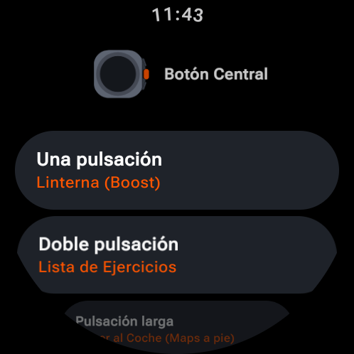
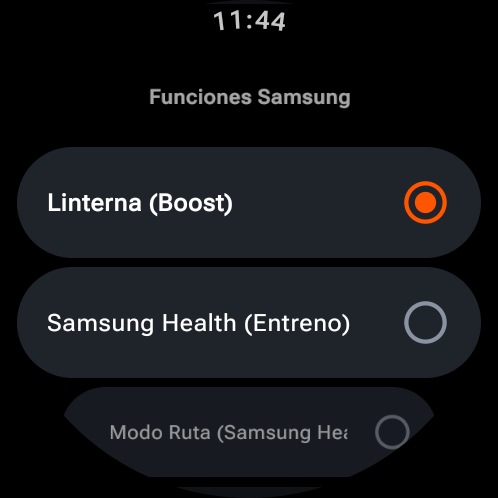
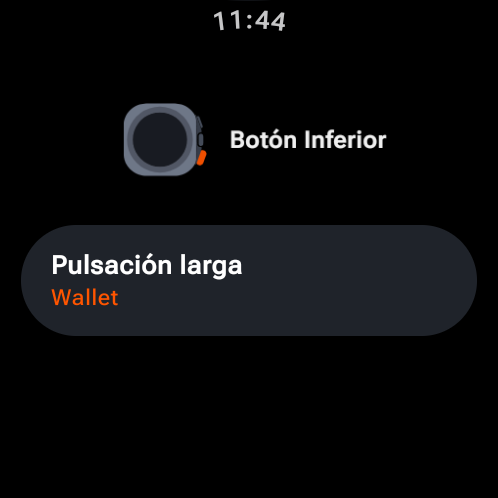
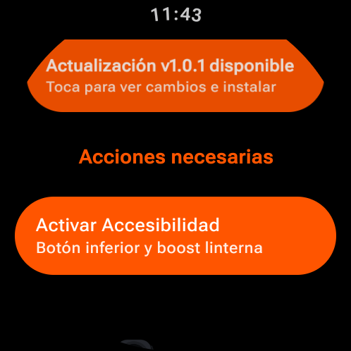
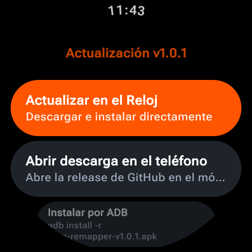

<p align="center">
  
</p>

<h1 align="center">Ultra Remapper</h1>

<p align="center">
  <b>Hardware Button Remapper for Samsung Galaxy Watch Ultra, Ultra 2, Watch 8 Classic & Wear OS Watches</b><br/>
  <sub>Dynamic Hardware Detection · Quick Button & Bottom Button Mapping · Samsung Flashlight (Auto-Max / Boost) · Samsung Health Workouts & Favorites · Standalone OTA</sub>
</p>

<p align="center">
  <a href="https://github.com/Aaronhrndz/ultra-remapper/releases/latest">
    
  </a>
  <a href="https://ko-fi.com/Aaronhrndz">
    
  </a>
  <a href="LICENSE">
    
  </a>
  
</p>

<p align="center">
  
  
  
  
  
</p>

---

## Capabilities Overview

- **Physical Button Remapping**: Independent single, double, and long press customization for the **Quick / Center Button** (Galaxy Watch Ultra, Watch 8 Classic), **Bottom (Back) Button**, and **Top (Home) Button** (Hold) across Wear OS Samsung watches.
- **In-Watch Local ADB Wizard**: Pair and connect wireless ADB directly on the watch using native TLS 1.3 / SPAKE2 and mDNS discovery. Grant elevated permissions and manage system tweaks completely on-device without a PC or phone.
- **Samsung Pay / Wallet Freeze**: One-tap toggle to freeze or disable Samsung Pay (pm disable-user --user 0 com.samsung.android.samsungpay.gear), eliminating system intercept conflicts for 100% reliable bottom-button long press gestures.
- **Dedicated Permissions Management**: Clean, focused permissions screen with auto-centering to grant Overlay, Secure Settings, Action Route, Notification Listener, and Battery Whitelist privileges via local ADB.
- **Samsung Health & System Actions**: Instant shortcuts to pinned workouts, official Flashlight (with automatic hardware Max/Boost and retry loop), Stopwatch, Water Lock, and Digital Assistant.
- **Smart Utilities**: One-click Wireless ADB toggle, GPS parking saver & walking navigation, water eject speaker sweep, LTE toggle, and tactical red flashlight.
- **Phone Media Controls**: Wrist-based media playback and volume control bridging local and phone sessions (Spotify, YouTube, KDE Connect).
- **Autonomous In-Watch OTA**: Background release checks with in-watch installer and live progress bar — no PC or phone app required for updates.
- **Smart Diagnostics & Marquee Text**: Warning banners only appear when an active shortcut needs attention; text automatically marquees across circular watch displays to avoid truncation.

> [!TIP]
> For the complete breakdown of every action and tool, explore the [**Full Feature List**](docs/FEATURES.md).

---

## Download & Installation

Download the latest prebuilt APK from the [**Releases**](https://github.com/Aaronhrndz/ultra-remapper/releases/latest) page (`ultra-remapper-vX.X.X.apk`).

> [!IMPORTANT]
> **Charging State Note**: When placed on the magnetic charger dock, Wear OS enters battery charging mode and suspends accessibility and button remapping to prevent phantom touches. Button remapping resumes automatically once taken off the charger.

> [!NOTE]
> **Samsung Health Foreground Coexistence**: Button remapping remains active across the system. When Samsung Health is actively on screen, custom actions execute seamlessly alongside native exercise tracking.

> [!WARNING]
> **Upgrading from older versions**: Starting in **v1.3.22**, the package name changed to `com.aaronhrndz.ultraremapper`. If you previously had **v1.3.21 or older** installed, **uninstall it completely before installing this version** to prevent duplicate apps or permission conflicts.

> [!TIP]
> For the complete breakdown of which features need elevated permissions, check the [**Permissions & Actions Reference**](docs/PERMISSIONS.md).

---

### ⌚ Standalone Setup directly on the Watch (No PC or Phone required)

Starting in **v2.2.0**, Ultra Remapper features an **integrated Local ADB Wizard**:
1. Connect the watch to Wi-Fi.
2. In watch **Settings › Developer options › Wireless debugging**, enable it and tap **Pair new device**.
3. Open Ultra Remapper, go to **Settings › ADB Settings › Pair / Connect ADB**, and enter the 6-digit code shown on screen.
4. Go to **Settings › ADB Settings › Permissions** to grant all elevated permissions (Overlay, Secure Settings, Action Route, Notification Listener, Battery Whitelist) and freeze Samsung Pay with 1 tap directly on your wrist!

---

### ⚡ Alternative: Quick Setup via PC / Terminal Wireless ADB

1. Enable **Settings → Developer options → ADB debugging** and **Wireless debugging** on your watch, then pair and connect:
   ```bash
   adb pair <WATCH_IP>:<PAIRING_PORT>
   adb connect <WATCH_IP>:<CONNECTION_PORT>
   ```
2. Install the downloaded APK:
   ```bash
   adb install -r ultra-remapper-*.apk
   ```

> [!TIP]
> ### 🚀 Recommended: All-In-One Megacommand
> Run this single command block in your terminal (PowerShell, CMD or Bash) to **automatically grant all 4 elevated permissions and configure hardware buttons in one second**:
>
> ```bash
> adb shell "settings put global setting_action_button_press com.aaronhrndz.ultraremapper/com.aaronhrndz.ultraremapper.ActionButtonService && settings put global setting_home_key_long_press googlevoiceassistant/googlevoiceassistant && settings put secure assistant com.aaronhrndz.ultraremapper/.AppVoiceInteractionService && settings put secure voice_interaction_service com.aaronhrndz.ultraremapper/.AppVoiceInteractionService && settings put secure enabled_accessibility_services com.aaronhrndz.ultraremapper/com.aaronhrndz.ultraremapper.BottomButtonService && settings put secure accessibility_enabled 1 && appops set com.aaronhrndz.ultraremapper SYSTEM_ALERT_WINDOW allow && cmd notification allow_listener com.aaronhrndz.ultraremapper/com.aaronhrndz.ultraremapper.MediaControlService && pm grant com.aaronhrndz.ultraremapper android.permission.WRITE_SECURE_SETTINGS && pm grant com.aaronhrndz.ultraremapper android.permission.ACCESS_FINE_LOCATION && cmd deviceidle whitelist +com.aaronhrndz.ultraremapper"
> ```
> *This automatically enroutes the Action Button, enables Accessibility for the Back key, unlocks Overlays and Media Listener, and grants Secure Settings with zero manual steps.*

<details>
<summary><b>🔧 Advanced: Grant permissions individually (Step-by-Step)</b></summary>

If you prefer to grant permissions manually one by one instead of using the megacommand:

- **1. Route Quick / Action Button**:
  ```bash
  adb shell settings put global setting_action_button_press com.aaronhrndz.ultraremapper/com.aaronhrndz.ultraremapper.ActionButtonService
  ```
- **2. Enable Accessibility Service** (Bottom / Back button remapping):
  ```bash
  adb shell settings put secure enabled_accessibility_services com.aaronhrndz.ultraremapper/com.aaronhrndz.ultraremapper.BottomButtonService
  adb shell settings put secure accessibility_enabled 1
  ```
- **4. Allow Overlay Permission** (floating UI & full-screen red flashlight):
  ```bash
  adb shell appops set com.aaronhrndz.ultraremapper SYSTEM_ALERT_WINDOW allow
  ```
- **5. Enable Media Bridge** (phone media controls & volume sync):
  ```bash
  adb shell cmd notification allow_listener com.aaronhrndz.ultraremapper/com.aaronhrndz.ultraremapper.MediaControlService
  ```
- **6. Grant Secure Settings & GPS Location** (LTE toggle, glove mode, parking GPS):
  ```bash
  adb shell pm grant com.aaronhrndz.ultraremapper android.permission.WRITE_SECURE_SETTINGS
  adb shell pm grant com.aaronhrndz.ultraremapper android.permission.ACCESS_FINE_LOCATION
  ```
- **7. Battery Whitelist** (prevent service sleep):
  ```bash
  adb shell cmd deviceidle whitelist +com.aaronhrndz.ultraremapper
  ```

> **Note:** Changing the Quick Button mapping inside Samsung's native Watch Settings will overwrite the Action Button routing. To restore Samsung's default Quick Button behavior at any time:
> ```bash
> adb shell settings put global setting_action_button_press com.samsung.android.wear.shealth/com.samsung.android.wear.shealth.service.ActionButtonService
> ```

</details>
---

## ☕ Support & Donations

If Ultra Remapper made your Galaxy Watch experience significantly better, consider supporting future development with a coffee:

<p align="center">
  <a href="https://ko-fi.com/Aaronhrndz">
    
  </a>
</p>

---

## Credits & Acknowledgments

This project is an independent evolution of [**bennybar/ultra-remapper**](https://github.com/bennybar/ultra-remapper), originally created by [**@bennybar**](https://github.com/bennybar). Credit to Benny for reverse-engineering Samsung's `setting_action_button_press` service mechanism.

---

## License

Licensed under the **GNU General Public License v3.0 (GPL-3.0)**. See [LICENSE](LICENSE) for full details.
