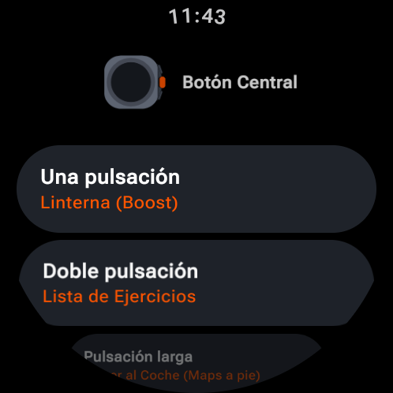
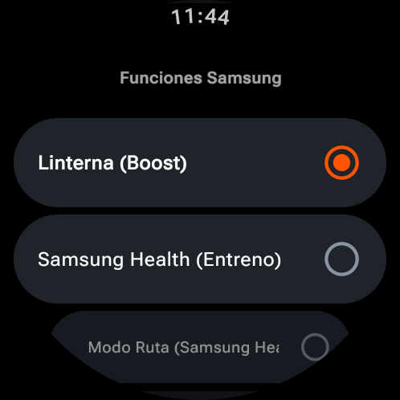
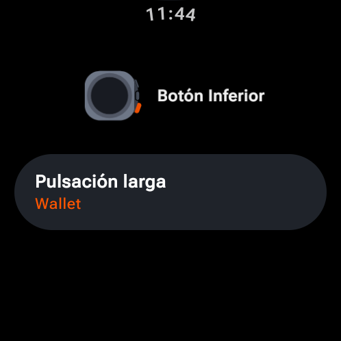
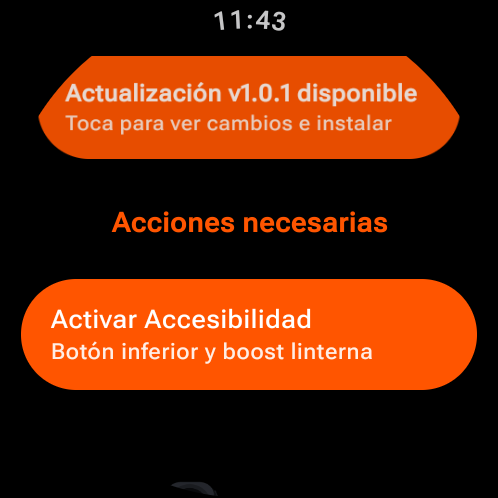
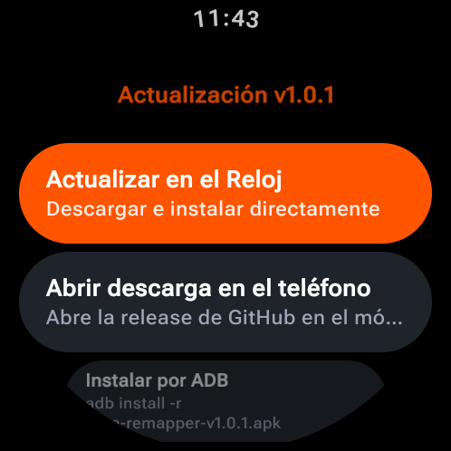

<p align="center">
  
</p>

<h1 align="center">Ultra Remapper</h1>

<p align="center">
  <b>Remap the Orange Quick Button & Bottom Button on Samsung Galaxy Watch Ultra & Ultra 2 (Wear OS)</b><br/>
  <sub>Samsung Flashlight Boost · Samsung Health Workouts · Water Lock · Bridged Media & KDE Connect · Launch Any App</sub>
</p>

<p align="center">
  <a href="https://github.com/Aaronhrndz/ultra-remapper/releases/latest">
    
  </a>
  <a href="LICENSE">
    
  </a>
  
</p>

<p align="center">
  
  
  
  
  
</p>

---

## Features

- **Orange Quick Button & Bottom Button**:
  - Independently map **Single Press**, **Double Press**, and **Long Press** on the Orange Quick Button, plus **Long Press** on the Bottom Button (preserving short press for *Back*).
- **Direct In-Watch Updates (Autonomous OTA)**:
  - Automatic GitHub release detection with a one-tap direct download and in-watch installer (`PackageInstaller` + `FileProvider`) — no phone app or ADB required for future updates.
- **Categorized Action Picker**:
  - **Smart Utilities**:
    - **Save Parking Spot & Navigate to Car**: Saves exact GPS coordinates with 1 press and opens Google Maps in walking navigation mode (`google.navigation:q=LAT,LON&mode=w`).
    - **Sideload / Keep-Awake Mode**: Keeps the screen awake and prevents WiFi/ADB timeout when installing apps over wireless ADB, preventing re-prompting for lock screen PINs.
    - **Touch Sensitivity (Glove Mode)**: Toggles Samsung high-sensitivity screen mode for gloves or wet hands.
    - **Red Flashlight (Max)**: Full-screen red light at 100% brightness (tactical night vision preserving).
    - **Do Not Disturb**: Quick toggle for DND with tactile vibration feedback.
    - **Water Eject Speaker**: High-resonance 165 Hz pulsing acoustic wave at maximum hardware volume with vibration pulses to expel water droplets from the speaker grille.
    - **LTE & Mobile Data**: Toggle cellular connectivity on LTE watch variants.
  - **Home Assistant Companion**:
    - **Home Assistant Assist (Voice)**: Launches the native voice assistant of the official Home Assistant Companion app without needing server logins on the watch.
  - **Samsung Functions**:
    - **Route Workout Mode**: Direct shortcut to launch Samsung Health Route & GPX workout view (`shealth_route`).
    - **Flashlight (Boost)**: Opens Samsung's official Wear OS Flashlight (`com.samsung.android.watch.flashlight`), verifies active foreground window, steps up to **Boost (maximum) brightness** (`level 12`), and toggles off cleanly on repeat press. Uses dynamic `serviceInfo` event subscription so idle battery impact is **zero**.
    - **Find My Phone**: Rings your paired phone via Samsung Find or Google Find My Device.
    - **Samsung Health Workout**: Triggers Samsung's native Quick Button workout start/pause (`ActionButtonService`).
    - **Samsung Health Exercise List** & **Pick Quick Workout**: Jump straight into Samsung Health exercises or configure the native workout shortcut.
    - **Stopwatch**: Launches Samsung Stopwatch (`com.samsung.android.watch.stopwatch`).
    - **Water Lock**: Activates Samsung's native Water Lock mode (`StWaterLockSettingActivity`).
    - **Digital Assistant**: Triggers Google Assistant / Gemini (`ACTION_VOICE_COMMAND`).
  - **Media & Volume (with Bridged Phone & KDE Connect Support)**:
    - **Play / Pause**, **Next Track**, **Previous Track**, **Volume Up**, **Volume Down**, and **Open Media Controller**.
    - Works with both local watch audio and **bridged phone media sessions** (including **KDE Connect** controlling a tablet or PC, Spotify, YouTube, etc.) via `MediaSessionManager` + `NotificationListenerService`.
  - **Open App…**:
    - Dedicated app submenu with real circular app icons for every installed launcher app.
- **Multilingual Support**:
  - Full UI and action translations in **English**, **Español**, **Deutsch**, and **Français**.
- **Smart Contextual Diagnostics**:
  - Action Required banners (*"Acciones necesarias"*) appear only if the user's selected actions actually demand elevated permissions (e.g. Accessibility only for bottom button/flashlight boost, Secure Settings only for glove/LTE/sideload mode). Basic app launches and Samsung stock actions require zero extra permissions.

---

## Download & Installation

Download the latest prebuilt APK from the [**Releases**](https://github.com/Aaronhrndz/ultra-remapper/releases/latest) page (`ultra-remapper-v1.0.0.apk`).

### One-Time Setup via Wireless ADB

1. Enable **Settings → Developer options → ADB debugging** and **Wireless debugging** on your watch, then pair and connect:
   ```bash
   adb pair <WATCH_IP>:<PAIRING_PORT>
   adb connect <WATCH_IP>:<CONNECTION_PORT>
   ```
2. Install the APK:
   ```bash
   adb install -r ultra-remapper-v0.9.0.apk
   ```
3. Route the Orange Quick Button to **Ultra Remapper**:
   ```bash
   adb shell settings put global setting_action_button_press com.bennybar.ultraremapper/com.bennybar.ultraremapper.ActionButtonService
   ```
4. Allow background app/activity launches and exempt from battery optimization:
   ```bash
   adb shell appops set com.bennybar.ultraremapper SYSTEM_ALERT_WINDOW allow
   adb shell cmd deviceidle whitelist +com.bennybar.ultraremapper
   ```
5. Enable the **Accessibility Service** (for Bottom Button long-press and Flashlight Boost/toggle):
   ```bash
   adb shell appops set com.bennybar.ultraremapper ACCESSIBILITY Allow
   adb shell settings put secure enabled_accessibility_services com.bennybar.ultraremapper/com.bennybar.ultraremapper.BottomButtonService
   adb shell settings put secure accessibility_enabled 1
   ```
6. Enable the **Media Session Bridge** (so Media Play/Pause/Next/Prev controls bridged phone notifications like **KDE Connect**, Spotify, etc.):
   ```bash
   adb shell cmd notification allow_listener com.bennybar.ultraremapper/com.bennybar.ultraremapper.MediaControlService
   ```
7. Grant **Location & Secure Settings** (for Parking GPS, LTE toggle, and Glove Mode):
   ```bash
   adb shell pm grant com.bennybar.ultraremapper android.permission.ACCESS_FINE_LOCATION
   adb shell pm grant com.bennybar.ultraremapper android.permission.WRITE_SECURE_SETTINGS
   ```

> **Note:** Changing the Quick Button mapping inside Samsung's native Watch Settings will overwrite step 3. To restore Samsung's default Quick Button behavior at any time:
> ```bash
> adb shell settings put global setting_action_button_press com.samsung.android.wear.shealth/com.samsung.android.wear.shealth.service.ActionButtonService
> ```

---

## Credits & Acknowledgments

This project is an independent evolution of [**bennybar/ultra-remapper**](https://github.com/bennybar/ultra-remapper), originally created by [**@bennybar**](https://github.com/bennybar). Credit to Benny for reverse-engineering Samsung's `setting_action_button_press` service mechanism.

---

## License

Licensed under the **GNU General Public License v3.0 (GPL-3.0)**. See [LICENSE](LICENSE) for full details.
